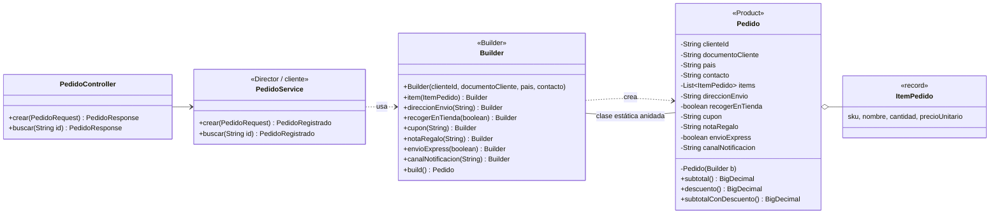
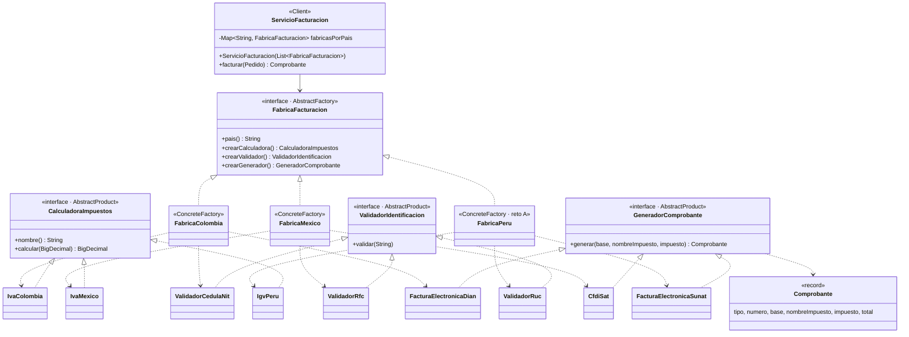
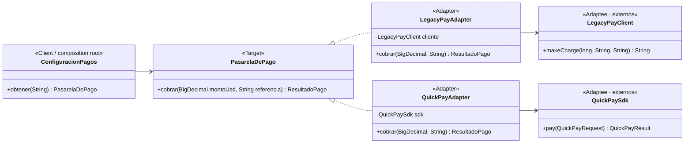
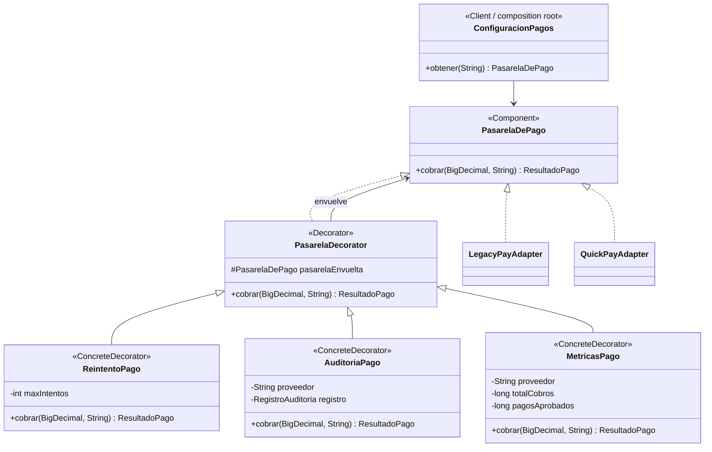
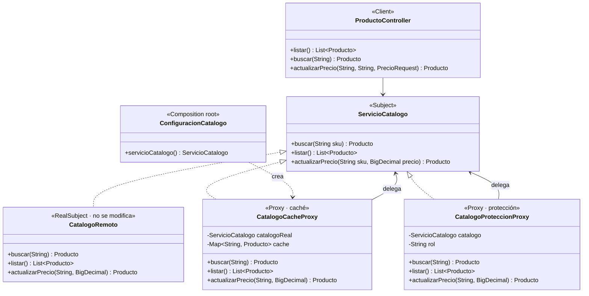
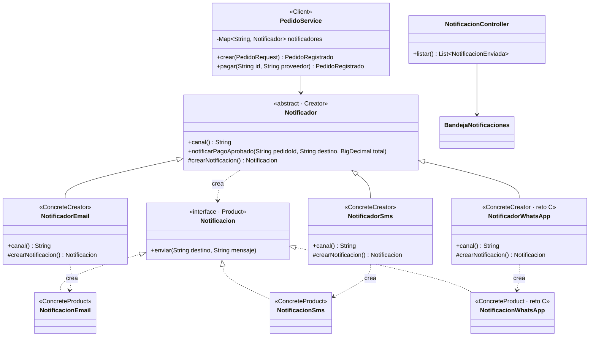

# ShopFlow · Taller de patrones de diseño

API REST de pedidos de ShopFlow (Colombia y México, precios en USD) construida con seis patrones
de diseño, los tres retos de extensión y pruebas JUnit 5.

**Repositorio:** <https://github.com/sanchavarro/Taller_ShopFlow>

## 1. Integrantes, roles y ejecución

| Integrante | Rol | Patrones / reto |
|---|---|---|
| Santiago Chavarro | A | Builder, Abstract Factory y reto A (Perú) |
| Andres Jarro | B | Adapter, Decorator y reto B (métricas) |
| Santiago Luna | C | Proxy, Factory Method y reto C (WhatsApp) |

### Requisitos

- Java 17 o superior (el proyecto compila con Java 17; se probó con Java 21).
- Maven 3.9 o superior.
- Git Bash (solo para ejecutar los scripts de evidencias en Windows).

### Ejecutar

```bash
git clone https://github.com/sanchavarro/Taller_ShopFlow.git
cd Taller_ShopFlow/shopflow-base
mvn spring-boot:run
```

La API queda en `http://localhost:8080`.

### Pruebas

```bash
cd shopflow-base
mvn test
```

Hay 28 pruebas en 10 clases. Las de los patrones del rol C son
`CatalogoCacheProxyTest`, `CatalogoProteccionProxyTest`, `NotificadorEmailTest`,
`NotificadorSmsTest` y `NotificadorWhatsAppTest`. También se agregó `LegacyPayAdapterTest`
para cubrir la prueba sugerida del Adapter del rol B. La salida completa de `mvn test` está en
`evidencias/pruebas-unitarias.txt`.

### Evidencias

Cada script supone una aplicación recién iniciada. Para que el escenario 1 del rol C mida la
caché fría, ejecute `rol-c-escenarios.sh` antes de cualquier consulta a `SKU-003`; el script del
rol A consulta ese SKU en el reto A.

```bash
cd shopflow-base
bash evidencias/rol-c-escenarios.sh   # escenarios 1, 2 y 8 + retos C
bash evidencias/rol-a-escenarios.sh   # escenarios 3, 4, 5 y reto A
```

Los resultados quedan en `evidencias/`. Las salidas de `git diff --stat` de cada reto están en
`evidencias/reto-A-git-diff-stat.txt`, `evidencias/reto-B-git-diff-stat.txt` y
`evidencias/reto-C-git-diff-stat.txt`.

> `externos.*` y `catalogo/CatalogoRemoto` no se modificaron. Las únicas integraciones sobre
> archivos existentes son `catalogo/ConfiguracionCatalogo` (rol C), `pedidos/PedidoService`
> (rol C) y `pagos/configuracion/ConfiguracionPagos` (reto B, permitido por el enunciado).

## 2. Tabla de análisis de patrones (Anexo D)

| Patrón | Problema en ShopFlow (síntoma) | Participantes GoF → clases | Principio SOLID | Cuándo no usarlo |
|---|---|---|---|---|
| Abstract Factory | Cada país exige una familia de piezas que deben ir juntas (impuesto, documento y comprobante). Sin patrón, un `if (pais.equals("CO"))` se repite en varias clases, es fácil mezclar el IVA de un país con el comprobante de otro y abrir Perú obliga a editar cada `if`. | AbstractFactory: `FabricaFacturacion`. ConcreteFactory: `FabricaColombia`, `FabricaMexico`, `FabricaPeru`. AbstractProduct: `CalculadoraImpuestos`, `ValidadorIdentificacion`, `GeneradorComprobante`. ConcreteProduct: `IvaColombia`, `ValidadorCedulaNit`, `FacturaElectronicaDian`, `IvaMexico`, `ValidadorRfc`, `CfdiSat`, `IgvPeru`, `ValidadorRuc`, `FacturaElectronicaSunat`. Client: `ServicioFacturacion`. | OCP (un país nuevo es una fábrica nueva) y DIP (`ServicioFacturacion` depende de interfaces, no de las clases de cada país). | Cuando no hay familias (un solo producto) o cuando la familia cambia de forma con frecuencia: agregar un producto nuevo obliga a modificar la interfaz y todas las fábricas concretas. |
| Builder | Un pedido tiene 4 datos obligatorios, al menos un ítem y 6 opciones con reglas que dependen unas de otras. Sin patrón: un constructor de 11 parámetros en el que es fácil invertir dos `String`, o un objeto con setters que existe a medias y puede quedar inválido. | Product: `Pedido` (inmutable). Builder: `Pedido.Builder` (versión de Bloch, sin Builder abstracto). Director / cliente: `PedidoService.crear()`, que traduce el JSON a llamadas al builder. | SRP: `Pedido` representa el pedido y `Pedido.Builder` se encarga de construirlo y validarlo. | Para objetos con dos o tres parámetros, todos obligatorios: el builder duplica código sin aportar nada (por eso `ItemPedido` y `Comprobante` son records simples). |
| Adapter | Los SDK de LegacyPay y QuickPay tienen interfaces incompatibles con `PasarelaDePago` (nombres, tipos y códigos de respuesta distintos). Si `PedidoService` los usara directamente, dependería de `externos.*` y cada proveedor nuevo obligaría a tocar el dominio. | Target: `PasarelaDePago`. Adapter: `LegacyPayAdapter`, `QuickPayAdapter`. Adaptee: `LegacyPayClient`, `QuickPaySdk`. Client / composition root: `ConfiguracionPagos`. | DIP (el dominio depende de `PasarelaDePago`, no de los SDK) y SRP (cada adapter aísla la traducción de un proveedor). | Cuando solo existe un proveedor y su interfaz ya coincide con la que espera el cliente: el adapter agrega una capa sin beneficio. Si se puede modificar el SDK, tampoco hace falta. |
| Decorator | Hay que agregar reintentos, auditoría y métricas a cualquier pasarela sin modificar los adapters ni `PedidoService`, y poder activar o desactivar cada capa por configuración. | Component: `PasarelaDePago`. Decorator: `PasarelaDecorator`. ConcreteDecorator: `ReintentoPago`, `AuditoriaPago`, `MetricasPago`. Client: `ConfiguracionPagos`. | OCP (una capa nueva no modifica las existentes), LSP (una pasarela decorada se usa donde se espera `PasarelaDePago`) y SRP (cada decorador tiene una sola responsabilidad). | Cuando el comportamiento es fijo o no se combina: una subclase o unas pocas líneas directas son más simples. Muchas capas también dificultan depurar y leer la pila. |
| Proxy | `CatalogoRemoto` tarda 1,5 s por llamada y el precio solo debe cambiarlo un ADMIN. Sin patrón, cada consulta paga la latencia, la caché se dispersa por los servicios y la validación del rol se repite en cada controlador. | Subject: `ServicioCatalogo`. RealSubject: `CatalogoRemoto`. Proxy: `CatalogoCacheProxy` (caché) y `CatalogoProteccionProxy` (control de acceso). Client: `ProductoController` y `PedidoService`. Composition root: `ConfiguracionCatalogo`. | SRP (caché y permisos en proxies separados), OCP (se agregan proxies sin tocar el sujeto real), LSP (el proxy sustituye al sujeto real) y DIP (el cliente depende de `ServicioCatalogo`). | Cuando el sujeto es local y rápido o no hay control de acceso: el proxy agrega indirección. Una caché exige estrategia de invalidación; si los datos cambian por fuera, puede servir precios viejos. |
| Factory Method | Al aprobar un pago hay que notificar por el canal elegido. El proceso es fijo (armar mensaje → crear notificación → enviar), pero cada canal valida el destino y formatea distinto. Si `PedidoService` decide con `if`, cada canal nuevo obliga a modificarlo. | Creator: `Notificador`. ConcreteCreator: `NotificadorEmail`, `NotificadorSms`, `NotificadorWhatsApp`. Product: `Notificacion`. ConcreteProduct: `NotificacionEmail`, `NotificacionSms`, `NotificacionWhatsApp`. Client: `PedidoService`. | OCP (WhatsApp son archivos nuevos), DIP (`PedidoService` depende de `Notificador`/`Notificacion`, no de las clases concretas) y SRP (cada creador/producto atiende un canal). | Cuando solo hay un canal o la creación del producto es trivial: un creador abstracto y una jerarquía de productos sobran. Si el proceso cambia por canal, quizá convenga Strategy en lugar de Factory Method. |

## 3. Patrones

### Builder

**Problema que resuelve.** `POST /api/pedidos` recibe datos obligatorios (cliente, documento,
país, contacto y al menos un ítem) y seis opciones (dirección, recoger en tienda, cupón, nota de
regalo, envío express y canal). Hay reglas que cruzan varias opciones: la dirección es
obligatoria si no se recoge en tienda, recoger en tienda y express son incompatibles y la nota de
regalo admite máximo 140 caracteres. Con el Builder esas reglas viven en un solo lugar
(`build()`) y el `Pedido` nunca existe a medias.

**Cómo quedó.**

- `Pedido` es `final`, todos sus atributos son `final`, el constructor es privado y no tiene setters.
- `Pedido.Builder` es una clase estática anidada: los obligatorios van en su constructor, cada
  opción devuelve el propio builder y `build()` valida todo y lanza `IllegalArgumentException`
  (que `ManejadorErrores` convierte en 400).
- `ItemPedido` (record) toma el precio del catálogo en `PedidoService`, no del JSON del cliente.
- El cupón `BOSQUE10` aplica 10 % sobre el subtotal; un cupón desconocido responde 400.

```java
Pedido pedido = new Pedido.Builder(clienteId, documento, pais, contacto)   // obligatorios
        .item(teclado).item(mouse)
        .direccionEnvio("Calle 134 # 9-51, Bogotá")
        .cupon("BOSQUE10")
        .envioExpress(true)
        .canalNotificacion("EMAIL")
        .build();                                                          // valida y crea
```



**Endpoint que lo evidencia.** `POST /api/pedidos` (201, o 400 si se viola una regla) y
`GET /api/pedidos/{id}`. Escenarios 3 y 4 del Anexo B (`evidencias/escenario-3.txt` y
`evidencias/escenario-4.txt`).

### Abstract Factory

**Problema que resuelve.** Facturar un pedido exige tres piezas que deben ser del mismo país:
el impuesto, la validación del documento del cliente y el comprobante electrónico. Si un pedido
mexicano se valida con reglas colombianas, la factura queda mal. `ServicioFacturacion` recibe la
fábrica del país del pedido y le pide las tres piezas: como todas salen de la misma fábrica, no se
pueden mezclar.

| País | Impuesto | Documento | Comprobante |
|---|---|---|---|
| CO | IVA 19 % | Cédula o NIT, 6 a 10 dígitos | Factura electrónica (DIAN), `FE-CO-n` |
| MX | IVA 16 % | RFC (p. ej. `GODE561231GR8`) | CFDI (SAT), `CFDI-MX-n` |
| PE (reto) | IGV 18 % | RUC, 11 dígitos | Factura electrónica (SUNAT), `FE-PE-n` |

**Cómo quedó.**

- `ServicioFacturacion` recibe `List<FabricaFacturacion>` (Spring inyecta todas las `@Component`),
  arma un `Map` por país y factura **sin ningún `if` ni `switch` por país**. Un país sin fábrica
  responde 400.
- Cada país vive en su propio paquete (`facturacion.colombia`, `facturacion.mexico`,
  `facturacion.peru`). Solo la fábrica es pública; los productos concretos son de paquete, así que
  ninguna clase fuera del paquete del país puede depender de ellos (DIP reforzado por el compilador).
- El comprobante se incluye en la respuesta de `POST /api/pedidos`.



**Endpoint que lo evidencia.** El campo `comprobante` de la respuesta de `POST /api/pedidos`.
Escenarios 3 y 5 del Anexo B (`evidencias/escenario-3.txt` y `evidencias/escenario-5.txt`).

### Adapter

**Problema que resuelve.** ShopFlow cobra con LegacyPay y QuickPay. Sus SDK viven en
`externos.*` y no se pueden modificar: LegacyPay recibe centavos y devuelve un `String` como
`"00|LP123"`; QuickPay recibe un `QuickPayRequest` con `double` y devuelve un `QuickPayResult`.
El dominio necesita una sola interfaz (`PasarelaDePago`) que reciba `BigDecimal` y devuelva
`ResultadoPago`, sin filtrar excepciones ni tipos de los SDK.

**Cómo quedó.**

- `LegacyPayAdapter` convierte el monto a centavos, traduce los códigos `00`, `51`, `05` y
  convierte `LegacyPayTimeoutException` en `PasarelaNoDisponibleException` (503).
- `QuickPayAdapter` arma el `QuickPayRequest`, traduce `OK`, `REJECTED` y `ERROR` y conserva el
  detalle del proveedor.
- `ConfiguracionPagos` es el único lugar que conoce las clases concretas y entrega las pasarelas
  indexadas por proveedor. Ninguna clase fuera de `pagos.adapter` importa `externos.*`.
- Un cobro mayor a 2.000 USD con LegacyPay queda rechazado con "Fondos insuficientes" (409); con
  QuickPay, el límite es 5.000 USD.



**Endpoint que lo evidencia.** `POST /api/pedidos/{id}/pago` con `{"proveedor":"LEGACYPAY"}` o
`{"proveedor":"QUICKPAY"}`. Escenario 7 del Anexo B (`evidencias/escenario-7.txt`).

### Decorator

**Problema que resuelve.** Además de cobrar, ShopFlow necesita reintentar cuando el proveedor no
está disponible, auditar cada cobro y medir la tasa de aprobación. Si esas responsabilidades se
metieran en cada adapter, se duplicarían y `PedidoService` tendría que activarlas con `if`. El
Decorator permite envolver la pasarela en capas y cambiar la composición desde configuración.

**Cómo quedó.**

- `PasarelaDecorator` implementa `PasarelaDePago`, guarda la pasarela envuelta y delega.
- `ReintentoPago` reintenta solo `PasarelaNoDisponibleException` hasta `maxIntentos`.
- `AuditoriaPago` registra una entrada por cada llamada a `cobrar` (incluye el resultado y la
  duración) en `RegistroAuditoria`; `GET /api/pagos/auditoria` lo expone.
- `MetricasPago` cuenta cobros y aprobados por proveedor y escribe la tasa en consola.
- El orden de `ConfiguracionPagos` es `MetricasPago(AuditoriaPago(ReintentoPago(adapter)))`:
  la auditoría queda por fuera del reintento, así que hay **una entrada por cobro**, no una por
  intento.
- Las capas se activan con `shopflow.pagos.auditoria`, `shopflow.pagos.reintentos` y
  `shopflow.pagos.max-intentos`.



**Endpoint que lo evidencia.** `GET /api/pagos/auditoria` después de pagar. Escenarios 6, 7 y 8
del Anexo B (`evidencias/escenario-6.txt`, `evidencias/escenario-7.txt` y
`evidencias/escenario-8.txt`).

### Proxy

**Problema que resuelve.** `CatalogoRemoto` simula un servicio de otro equipo: cada llamada tarda
1,5 s. Además, el precio solo lo puede cambiar un ADMIN. Sin patrón, `PedidoService` y el
controlador pagarían la latencia en cada consulta y repetirían la validación del rol. El Proxy
ofrece la misma interfaz `ServicioCatalogo` y controla el acceso al sujeto real.

**Cómo quedó.**

- `CatalogoCacheProxy` implementa `ServicioCatalogo`, guarda un `Map<String, Producto>` y solo
  llama a `CatalogoRemoto` cuando el SKU no está en caché. `listar()` también llena la caché y
  `actualizarPrecio()` actualiza la entrada para no servir un precio viejo.
- `CatalogoProteccionProxy` implementa la misma interfaz y lanza `AccesoDenegadoException` (403)
  si el rol no es `ADMIN` al cambiar un precio. Los demás métodos se delegan.
- `ProductoController` expone `GET /api/productos`, `GET /api/productos/{sku}` y
  `PUT /api/productos/{sku}/precio`; este último lee `X-Rol` y envuelve el catálogo en el proxy
  de protección.
- `ConfiguracionCatalogo` entrega `new CatalogoCacheProxy(new CatalogoRemoto())` como el
  `ServicioCatalogo` de toda la aplicación. `PedidoService` y el controlador no saben que hay un
  proxy.
- El precio se valida antes de llegar al proxy: debe ser mayor que cero (400).



**Endpoint que lo evidencia.** `GET /api/productos/{sku}` (caché) y
`PUT /api/productos/{sku}/precio` con `X-Rol` (protección). Escenarios 1 y 2 del Anexo B
(`evidencias/escenario-1.txt` y `evidencias/escenario-2.txt`). La primera consulta de `SKU-003`
tardó 1,564754 s y la segunda 0,004809 s; con `X-Rol: CLIENTE` el PUT responde 403 y con
`X-Rol: ADMIN` responde 200 y la siguiente consulta muestra 299.90.

### Factory Method

**Problema que resuelve.** Cuando se aprueba un pago, ShopFlow notifica al cliente por el canal
elegido. El proceso es siempre el mismo (armar el mensaje, crear la notificación del canal y
enviarla), pero cada canal valida el destino y formatea distinto: el correo exige `@` y lleva
asunto; el SMS se recorta a 160 caracteres; WhatsApp exige indicativo y antepone `✅`. Si
`PedidoService` decide con `if` qué clase instanciar, cada canal nuevo obliga a modificarlo.

**Cómo quedó.**

- `Notificacion` es el producto: `enviar(destino, mensaje)`.
- `Notificador` es el creador abstracto. Su método `notificarPagoAprobado(...)` es `final`: arma
  el mensaje con el total, llama al método fábrica `crearNotificacion()` y envía. Declara
  `canal()`.
- `NotificadorEmail` y `NotificadorSms` son `@Component`; cada uno sobrescribe
  `crearNotificacion()` y usa `BandejaNotificaciones`.
- `PedidoService` recibe `List<Notificador>`, los indexa por canal en un `Map` y, después de un
  pago aprobado, llama al notificador del canal del pedido. No contiene `new Notificacion...` ni
  un `if` por canal. Un canal no soportado responde 400 antes de facturar.
- `GET /api/notificaciones` devuelve la bandeja con canal, destino, mensaje y fecha.



**Endpoint que lo evidencia.** `POST /api/pedidos` con `canalNotificacion`, luego
`POST /api/pedidos/{id}/pago` y `GET /api/notificaciones`. Escenario 8 del Anexo B
(`evidencias/escenario-8.txt`) y reto C (`evidencias/reto-C-whatsapp.txt`). El archivo del
escenario 8 muestra tres entradas de auditoría (una por cobro) y tres notificaciones (EMAIL, SMS y
WHATSAPP), cada una con el total pagado.

## 4. Retos de extensión

### Reto A · Perú (Abstract Factory)

Se agregó `FabricaPeru` (IGV 18 %, RUC de 11 dígitos y «Factura electrónica (SUNAT)») con sus tres
productos concretos y una prueba. Spring la registra por ser `@Component` y `ServicioFacturacion`
la recibe en su lista: no se tocó ninguna clase existente.

Evidencia (`evidencias/reto-A-git-diff-stat.txt`):

```text
$ git diff --stat 64b6889 1c15d8b   (commit del reto A)
 .../shopflow/facturacion/peru/FabricaPeru.java     | 39 ++++++++++++++++++++
 .../facturacion/peru/FacturaElectronicaSunat.java  | 22 ++++++++++++
 .../shopflow/facturacion/peru/IgvPeru.java         | 21 +++++++++++
 .../shopflow/facturacion/peru/ValidadorRuc.java    | 17 +++++++++
 .../shopflow/facturacion/peru/FabricaPeruTest.java | 42 ++++++++++++++++++++++
 5 files changed, 141 insertions(+)
```

Los cinco archivos son nuevos (`A` en `git show --name-status`); ningún archivo existente aparece
como modificado. La salida HTTP del pedido peruano está en `evidencias/reto-A-peru.txt`.

### Reto B · Métricas (Decorator)

Se agregó `MetricasPago` y se modificó únicamente `ConfiguracionPagos` para envolver cada pasarela
con la nueva capa, que es la excepción permitida por el enunciado. `MetricasPago` cuenta cobros y
aprobados por proveedor y escribe en consola la tasa después de cada cobro.

Evidencia (`evidencias/reto-B-git-diff-stat.txt`):

```text
git diff --stat
 .../pagos/configuracion/ConfiguracionPagos.java    |  3 +
 .../shopflow/pagos/decorator/MetricasPago.java     | 64 ++++++++++++++++++++++
 2 files changed, 67 insertions(+)
```

La salida de consola y la auditoría de un pago aprobado y uno rechazado están en
`evidencias/reto-B-metricas.txt`.

### Reto C · WhatsApp (Factory Method)

Se agregaron `NotificacionWhatsApp` (producto), `NotificadorWhatsApp` (creador `@Component`) y
`NotificadorWhatsAppTest`. El número debe incluir indicativo (`+573001234567`) y el mensaje se
antepone con `✅`. Un pedido con `"canalNotificacion": "WHATSAPP"` se notifica sin modificar
`PedidoService` ni los creadores existentes: Spring inyecta el nuevo `Notificador` en la lista.

Evidencia (`evidencias/reto-C-git-diff-stat.txt`):

```text
$ git diff --stat HEAD~1 HEAD
 .../notificaciones/NotificacionWhatsApp.java       | 27 ++++++++++++++++
 .../notificaciones/NotificadorWhatsApp.java        | 24 +++++++++++++
 .../notificaciones/NotificadorWhatsAppTest.java    | 36 ++++++++++++++++++++++
 3 files changed, 87 insertions(+)

$ git show --name-status --oneline HEAD
33779b0 reto C: agregar canal WhatsApp con Factory Method
A  shopflow-base/src/main/java/co/edu/unbosque/shopflow/notificaciones/NotificacionWhatsApp.java
A  shopflow-base/src/main/java/co/edu/unbosque/shopflow/notificaciones/NotificadorWhatsApp.java
A  shopflow-base/src/test/java/co/edu/unbosque/shopflow/notificaciones/NotificadorWhatsAppTest.java
```

Los tres archivos son nuevos. La notificación enviada y el 400 de un canal no soportado están en
`evidencias/reto-C-whatsapp.txt` y `evidencias/reto-C-canal-invalido.txt`.

## 5. Preguntas de reflexión

**1. ¿Cómo habría quedado `PedidoService` sin Factory Method ni Abstract Factory?**
La facturación necesitaría tres decisiones por país dentro del servicio: una para validar el
documento (`if CO → 6 a 10 dígitos; else if MX → RFC`), otra para calcular el impuesto (19 % o
16 %) y otra para armar el comprobante (DIAN o CFDI). A eso se suma la notificación: un `if` para
crear el correo o el SMS (y, en la práctica, otro para validar el destino). Son al menos cuatro
`if/else if` con dos ramas cada uno. Abrir Perú obligaría a agregar una rama en cada una de las
tres decisiones de facturación de `PedidoService`, y agregar WhatsApp, otra rama en la de
notificación: siempre se modifica la misma clase, que además se vuelve imposible de probar por
partes. Con los patrones, Perú fue una fábrica nueva (cinco archivos nuevos, cero modificados) y
WhatsApp es un creador concreto nuevo (tres archivos nuevos).

**2. ¿Por qué las notificaciones usan Factory Method y la facturación usa Abstract Factory?**
Porque notificar necesita **un solo producto** (la `Notificacion` del canal) dentro de un proceso
fijo (armar mensaje → crear → enviar); el creador abstracto `Notificador` fija el proceso y deja
que cada subclase decida qué notificación crear (herencia). Facturar, en cambio, necesita **una
familia de productos** (impuesto, validador y comprobante) que solo tienen sentido juntos; la
fábrica abstracta entrega las tres piezas y garantiza que sean del mismo país, y el cliente la
recibe como objeto (composición). Si la facturación se hiciera con tres Factory Method
independientes, nada impediría combinar el validador de México con el comprobante de Colombia.

**3. Invierta el orden de los decoradores (reintento por fuera de la auditoría) y pague cinco
pedidos con LegacyPay. ¿Qué cambia en `GET /api/pagos/auditoria`? ¿Qué orden conviene y por qué?**
Con la auditoría por dentro del reintento, cada intento fallido también se audita. LegacyPay tiene
una probabilidad de timeout configurable (0,3 por defecto) y `ReintentoPago` puede hacer hasta tres
intentos; cinco pagos podrían producir más de cinco entradas (por ejemplo, una por cada intento
fallido y una por el intento que finalmente responde). Con el orden actual
(`AuditoriaPago(ReintentoPago(adapter))`) hay exactamente **una entrada por cobro**, que es el
criterio de aceptación del taller y además mide la duración total que ve el cliente. Para depurar
fallos de red sí sería útil auditar cada intento, pero para el reporte de cobros conviene la
auditoría por fuera del reintento.

**4. `CatalogoCacheProxy` y `AuditoriaPago` tienen casi la misma estructura: implementan la
interfaz y envuelven un objeto. ¿Por qué uno es Proxy y el otro Decorator?**
La estructura es parecida, pero la intención es distinta. `CatalogoCacheProxy` **controla el
acceso** al sujeto real: decide si llama o no a `CatalogoRemoto` (caché) y el proxy de protección
decide si un rol puede llegar a `actualizarPrecio`. `AuditoriaPago` **agrega una
responsabilidad** que el cliente quiere (registrar cada cobro) y siempre delega la operación. El
Proxy representa al objeto y administra cuándo/cómo se accede a él; el Decorator conserva la
interfaz y añade comportamiento. Por eso el proxy de caché puede evitar la llamada al sujeto real,
mientras que el decorador de auditoría no puede evitar el cobro: lo envuelve.

**5. Si otro sistema cambia un precio directamente en el catálogo remoto, ¿qué problema tiene la
caché del proxy? Proponga una solución.**
La caché no se entera del cambio y sigue sirviendo el precio anterior hasta que se actualice la
entrada o se reinicie la aplicación. En ShopFlow, `actualizarPrecio` actualiza la caché cuando el
cambio pasa por el proxy, pero un cambio externo no pasa por ahí. Soluciones: un TTL corto para
cada entrada, un número de versión o ETag que el remoto devuelva y el proxy compare, invalidación
por evento/pub-sub desde el catálogo remoto, o una operación explícita de invalidación. Para
precios, lo más simple es TTL corto más invalidación al escribir; si el precio debe ser exacto,
conviene no cachear la lectura o validar la versión antes de usarla.

**6. `QuickPayAdapter` convierte `BigDecimal` a `double`. ¿Qué riesgo trae y por qué conviene que
esa decisión viva en el adapter y no en el dominio?**
`double` no representa exactamente todos los decimales; al convertir y volver a operar pueden
aparecer diferencias de centavos por redondeo (por ejemplo, 0,1 + 0,2 no es exactamente 0,3). En
dinero eso puede producir cobros o comprobantes con un centavo de diferencia. La conversión debe
vivir en el adapter porque es una limitación del SDK externo, no una regla de ShopFlow: el dominio
trabaja con `BigDecimal` y solo el borde de integración asume el `double`. Allí se puede redondear
y validar explícitamente; idealmente el SDK ofrecería enteros en la unidad mínima o `BigDecimal`.

**7. ¿En qué parte del proyecto no convenía aplicar un patrón? Justifique con el criterio «cuándo
no usarlo» del Anexo A.**
En `ItemPedido` y `Comprobante`. Ambos tienen pocos campos, todos obligatorios y sin reglas entre
ellos; según el criterio «cuándo no usarlo» del Builder (objetos de dos o tres parámetros
obligatorios), un builder solo duplicaría código y habría que mantenerlo con cada cambio de
atributos. Por eso son records con constructor canónico. Lo mismo con `EstadoPedido`: dos estados
fijos no justifican un patrón State. `Producto` también es un record simple y `CatalogoRemoto` no
se toca porque es un límite del proyecto base.

**8. Para cada patrón, indique el principio SOLID que aplica y cite la clase o la línea de código
que lo evidencia.**

| Patrón | Principio | Evidencia en el código |
|---|---|---|
| Builder | SRP | `Pedido` solo representa el pedido (atributos `final`, sin setters); todas las reglas viven en `Pedido.Builder#build()`. |
| Abstract Factory | OCP | El commit del reto A agrega `FabricaPeru` y no modifica ningún archivo (`evidencias/reto-A-git-diff-stat.txt`). |
| Abstract Factory | DIP | `ServicioFacturacion(List<FabricaFacturacion> fabricas)` y `facturar()` solo usan interfaces; los productos concretos son de paquete y no se pueden importar desde fuera. |
| Adapter | DIP | `PedidoService` y `ConfiguracionPagos` usan `PasarelaDePago`; solo `pagos.adapter` importa `externos.legacypay` y `externos.quickpay`. |
| Adapter | SRP | `LegacyPayAdapter` traduce centavos/códigos de LegacyPay y `QuickPayAdapter` traduce `QuickPayRequest`/`QuickPayResult`; ninguno contiene reglas de pedidos. |
| Decorator | OCP | `ConfiguracionPagos` agrega `MetricasPago` sin modificar `ReintentoPago`, `AuditoriaPago` ni los adapters. |
| Decorator | LSP | `PasarelaDecorator` implementa `PasarelaDePago` y puede sustituir a cualquier pasarela en `PedidoService`. |
| Proxy | SRP | `CatalogoCacheProxy` solo cachea y `CatalogoProteccionProxy` solo valida el rol; `CatalogoRemoto` sigue siendo el sujeto real. |
| Proxy | LSP | `ProductoController` y `PedidoService` reciben `ServicioCatalogo` y no distinguen si es el remoto o un proxy. |
| Factory Method | OCP | El reto C agrega `NotificadorWhatsApp` y `NotificacionWhatsApp` sin modificar `Notificador`, `NotificadorEmail`, `NotificadorSms` ni `PedidoService`. |
| Factory Method | DIP | `PedidoService` depende de `List<Notificador>` y de `Notificacion`; no importa `NotificacionEmail`, `NotificacionSms` ni `NotificacionWhatsApp`. |

## 6. Conclusiones y dificultades

**Conclusiones.**

- Los seis patrones permitieron separar responsabilidades y trabajar por ramas: el dominio de
  pedidos no conoce los SDK de pago, los países de facturación ni los canales de notificación.
- El Proxy redujo la segunda consulta de `SKU-003` de 1,564754 s a 0,004809 s y mantuvo la regla
  de precios en un solo lugar; el 403/200 se evidencia sin tocar `CatalogoRemoto`.
- El Factory Method hizo que WhatsApp fuera un creador y un producto nuevos (tres archivos,
  ningún archivo existente modificado) y dejó `PedidoService` sin `if` por canal.
- El Decorator permitió activar reintentos, auditoría y métricas por configuración; la auditoría
  por fuera del reintento cumple «una entrada por cobro».
- El Abstract Factory y el Builder ya estaban integrados por el rol A; el reto A demostró que
  Perú se agrega con cinco archivos nuevos. El reto B se integró modificando solo
  `ConfiguracionPagos`, como permite el enunciado.
- Las 28 pruebas JUnit 5 cubren reglas del Builder, familias de facturación, adapters/decoradores,
  caché/protección y los canales de notificación, sin depender de latencia real.

**Dificultades encontradas.**

- Integrar `PedidoService`: había que agregar la lista de notificadores sin romper la firma que ya
  usaba el rol A/B y validar el canal antes de facturar para que un canal no soportado diera 400.
- Ordenar las evidencias: el escenario 1 del rol C necesita `SKU-003` con caché fría, mientras que
  el script del rol A consulta ese SKU en el reto A; por eso se documenta ejecutar el script del
  rol C primero o reiniciar la aplicación entre scripts.
- Codificación en Windows/Git Bash: los acentos y el emoji `✅` se ven como `?` en algunas
  consolas, pero los archivos de evidencia quedan en UTF-8 y el JSON de la API conserva el emoji.
- La caché puede quedar desactualizada si un tercero cambia el catálogo remoto; se documentó la
  limitación y las alternativas de invalidación (TTL, versión/ETag o eventos).
- Mantener intactos `externos.*` y `CatalogoRemoto` obligó a que toda la traducción y toda la
  protección vivieran en adapters y proxies, no en las clases base.
