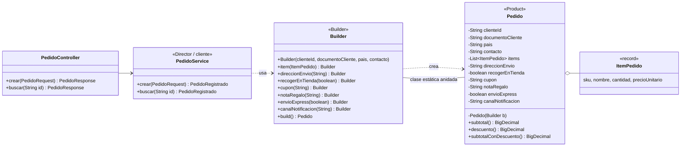
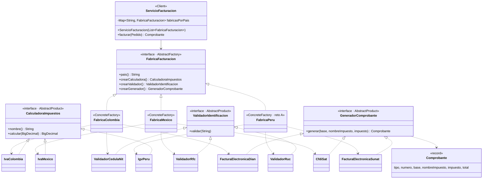

# Rol A · Builder y Abstract Factory

Responsable: Santiago Chavarro. Este archivo reúne lo que el rol A aporta a cada sección del README
para que el integrador lo copie en su lugar.

Commits de la rama `rol-a-builder-abstract-factory`:

| Commit | Contenido |
|---|---|
| Builder | `Pedido`, `Pedido.Builder`, `ItemPedido`, `PedidoService`, `PedidoController`, `PedidoBuilderTest` |
| Abstract Factory | paquete `facturacion` (Colombia y México), `ServicioFacturacion`, `ServicioFacturacionTest` |
| Reto A (Perú) | paquete `facturacion.peru` y `FabricaPeruTest`: solo archivos nuevos |

## Para el integrador

- **`catalogo/ConfiguracionCatalogo` es provisional.** Entrega `new CatalogoRemoto()` para que la
  aplicación arranque sin el Proxy. Al unir la rama del rol C, gana la versión del rol C
  (`new CatalogoCacheProxy(new CatalogoRemoto())`).
- **Pago (rol B):** `PedidoService` guarda `PedidoRegistrado` (inmutable). Para pagar:
  `buscar(id)`, verificar `estado() == EstadoPedido.CREADO` (si no, `IllegalStateException` → 409),
  cobrar `comprobante().total()` con la pasarela y guardar `registrado.pagado(autorizacion)`.
- **Notificaciones (rol C):** el canal llega normalizado en mayúsculas en `pedido().canalNotificacion()`
  (por defecto `EMAIL`) y el destino en `pedido().contacto()`. La validación de canal no soportado (400)
  va en `PedidoService` con el mapa de `Notificador`, antes de `build()` o justo después.
- Los escenarios 3, 4 y 5 y la prueba de Perú se generan con `bash evidencias/rol-a-escenarios.sh`
  con la aplicación recién iniciada (antes de los demás escenarios, para que el pedido de Colombia sea `PED-1`).

---

## Sección 2 · Tabla de análisis (Anexo D)

| Patrón | Problema en ShopFlow (síntoma) | Participantes GoF → clases | Principio SOLID | Cuándo no usarlo |
|---|---|---|---|---|
| Abstract Factory | Cada país exige una familia de piezas que deben ir juntas (impuesto, documento del cliente y comprobante). Sin patrón, un `if (pais.equals("CO"))` se repite en varias clases, es fácil mezclar el IVA de un país con el comprobante de otro y abrir Perú obliga a editar cada `if`. | AbstractFactory: `FabricaFacturacion`. ConcreteFactory: `FabricaColombia`, `FabricaMexico`, `FabricaPeru`. AbstractProduct: `CalculadoraImpuestos`, `ValidadorIdentificacion`, `GeneradorComprobante`. ConcreteProduct: `IvaColombia`, `ValidadorCedulaNit`, `FacturaElectronicaDian`, `IvaMexico`, `ValidadorRfc`, `CfdiSat`, `IgvPeru`, `ValidadorRuc`, `FacturaElectronicaSunat`. Client: `ServicioFacturacion`. | OCP (un país nuevo es una fábrica nueva) y DIP (`ServicioFacturacion` depende de interfaces, no de las clases de cada país). | Cuando no hay familias (un solo producto) o cuando la familia cambia de forma con frecuencia: agregar un producto nuevo obliga a modificar la interfaz y todas las fábricas concretas. |
| Builder | Un pedido tiene 4 datos obligatorios, al menos un ítem y 6 opciones con reglas que dependen unas de otras. Sin patrón: un constructor de 11 parámetros en el que es fácil invertir dos `String`, o un objeto con setters que existe a medias y puede quedar inválido. | Product: `Pedido` (inmutable). Builder: `Pedido.Builder` (versión de Bloch, sin Builder abstracto). Director / cliente: `PedidoService.crear()`, que traduce el JSON a llamadas al builder. | SRP: `Pedido` representa el pedido y `Pedido.Builder` se encarga de construirlo y validarlo. | Para objetos con dos o tres parámetros, todos obligatorios: el builder duplica código sin aportar nada (por eso `ItemPedido` y `Comprobante` son records simples). |

---

## Sección 3 · Patrones

### Builder

**Problema que resuelve.** `POST /api/pedidos` recibe un pedido con datos obligatorios (cliente, documento,
país, contacto y al menos un ítem) y seis opciones (dirección, recoger en tienda, cupón, nota de regalo,
envío express y canal). Hay reglas que cruzan varias opciones: la dirección es obligatoria si no se
recoge en tienda, recoger en tienda y express son incompatibles y la nota de regalo admite máximo 140
caracteres. Con el Builder esas reglas viven en un solo lugar (`build()`) y el `Pedido` nunca existe a medias.

**Cómo quedó.**

- `Pedido` es `final`, todos sus atributos son `final`, el constructor es privado y no tiene setters.
- `Pedido.Builder` es una clase estática anidada: los obligatorios van en su constructor, cada opción
  devuelve el propio builder y `build()` valida todo y lanza `IllegalArgumentException`
  (que `ManejadorErrores` convierte en 400).
- `ItemPedido` (record) toma el precio del catálogo en `PedidoService`, no del JSON del cliente.
- El cupón `BOSQUE10` aplica 10 % sobre el subtotal; un cupón desconocido responde 400.

```java
Pedido pedido = new Pedido.Builder(clienteId, documento, pais, contacto)   // obligatorios
        .item(teclado).item(mouse)
        .direccionEnvio("Calle 134 # 9-51, Bogotá")
        .cupon("BOSQUE10")
        .envioExpress(true)
        .canalNotificacion("EMAIL")
        .build();                                                          // valida y crea
```



**Endpoint que lo evidencia.** `POST /api/pedidos` (201, o 400 si se viola una regla) y `GET /api/pedidos/{id}`.
Escenarios 3 y 4 del Anexo B.

### Abstract Factory

**Problema que resuelve.** Facturar un pedido exige tres piezas que deben ser del mismo país:
el impuesto, la validación del documento del cliente y el comprobante electrónico. Si un pedido mexicano
se valida con reglas colombianas, la factura queda mal. `ServicioFacturacion` recibe la fábrica del país
del pedido y le pide las tres piezas: como todas salen de la misma fábrica, no se pueden mezclar.

| País | Impuesto | Documento | Comprobante |
|---|---|---|---|
| CO | IVA 19 % | Cédula o NIT, 6 a 10 dígitos | Factura electrónica (DIAN), `FE-CO-n` |
| MX | IVA 16 % | RFC (p. ej. `GODE561231GR8`) | CFDI (SAT), `CFDI-MX-n` |
| PE (reto) | IGV 18 % | RUC, 11 dígitos | Factura electrónica (SUNAT), `FE-PE-n` |

**Cómo quedó.**

- `ServicioFacturacion` recibe `List<FabricaFacturacion>` (Spring inyecta todas las `@Component`), arma un
  `Map` por país y factura **sin ningún `if` ni `switch` por país**. Un país sin fábrica responde 400.
- Cada país vive en su propio paquete (`facturacion.colombia`, `facturacion.mexico`, `facturacion.peru`).
  Solo la fábrica es pública; los productos concretos son de paquete, así que ninguna clase fuera del
  paquete del país puede depender de ellos (DIP reforzado por el compilador).
- El comprobante se incluye en la respuesta de `POST /api/pedidos`.



**Endpoint que lo evidencia.** El campo `comprobante` de la respuesta de `POST /api/pedidos`.
Escenarios 3 y 5 del Anexo B.

---

## Sección 4 · Reto A (Perú)

Se agregó `FabricaPeru` (IGV 18 %, RUC de 11 dígitos y «Factura electrónica (SUNAT)») con sus tres productos
concretos y una prueba. Spring la registra por ser `@Component` y `ServicioFacturacion` la recibe en su lista:
no se tocó ninguna clase existente.

Evidencia (`evidencias/reto-A-git-diff-stat.txt`):

```
$ git diff --stat HEAD~1 HEAD   (commit del reto A)
 .../shopflow/facturacion/peru/FabricaPeru.java     | 39 ++++++++++++++++++++
 .../facturacion/peru/FacturaElectronicaSunat.java  | 22 ++++++++++++
 .../shopflow/facturacion/peru/IgvPeru.java         | 21 +++++++++++
 .../shopflow/facturacion/peru/ValidadorRuc.java    | 17 +++++++++
 .../shopflow/facturacion/peru/FabricaPeruTest.java | 42 ++++++++++++++++++++++
 5 files changed, 141 insertions(+)
```

Los cinco archivos son nuevos (`A` en `git show --name-status`); ningún archivo existente aparece como modificado.
La salida HTTP del pedido peruano queda en `evidencias/reto-A-peru.txt` al ejecutar `rol-a-escenarios.sh`.

---

## Sección 5 · Preguntas de reflexión (aporte del rol A)

**1. ¿Cómo habría quedado `PedidoService` sin Factory Method ni Abstract Factory?**
La facturación necesitaría tres decisiones por país dentro del servicio: una para validar el documento
(`if CO → 6 a 10 dígitos; else if MX → RFC`), otra para calcular el impuesto (19 % o 16 %) y otra para armar
el comprobante (DIAN o CFDI). A eso se suma la notificación: un `if` para crear el correo o el SMS (y, en la
práctica, otro para validar el destino). Son al menos cuatro `if/else if` con dos ramas cada uno. Abrir Perú
obligaría a agregar una rama en cada una de las tres decisiones de facturación de `PedidoService`, y agregar
WhatsApp, otra rama en la de notificación: siempre se modifica la misma clase, que además se vuelve
imposible de probar por partes. Con los patrones, Perú fue una fábrica nueva (cinco archivos nuevos, cero
modificados) y WhatsApp es un creador concreto nuevo.

**2. ¿Por qué las notificaciones usan Factory Method y la facturación usa Abstract Factory?**
Porque notificar necesita **un solo producto** (la `Notificacion` del canal) dentro de un proceso fijo
(armar mensaje → crear → enviar); el creador abstracto `Notificador` fija el proceso y deja que cada subclase
decida qué notificación crear (herencia). Facturar, en cambio, necesita **una familia de productos**
(impuesto, validador y comprobante) que solo tienen sentido juntos; la fábrica abstracta entrega las tres
piezas y garantiza que sean del mismo país, y el cliente la recibe como objeto (composición). Si la
facturación se hiciera con tres Factory Method independientes, nada impediría combinar el validador de
México con el comprobante de Colombia.

**7. ¿En qué parte del proyecto no convenía aplicar un patrón?**
En `ItemPedido` y `Comprobante`. Ambos tienen pocos campos, todos obligatorios y sin reglas entre ellos;
según el criterio «cuándo no usarlo» del Builder (objetos de dos o tres parámetros obligatorios), un builder
solo duplicaría código y habría que mantenerlo con cada cambio de atributos. Por eso son records con
constructor canónico. Lo mismo con `EstadoPedido`: dos estados fijos no justifican un patrón State.

**8. Principio SOLID por patrón (rol A).**

| Patrón | Principio | Evidencia en el código |
|---|---|---|
| Builder | SRP | `Pedido` solo representa el pedido (atributos `final`, sin setters); todas las reglas viven en `Pedido.Builder#build()`. |
| Abstract Factory | OCP | El commit del reto A agrega `FabricaPeru` y no modifica ningún archivo (`evidencias/reto-A-git-diff-stat.txt`). |
| Abstract Factory | DIP | `ServicioFacturacion(List<FabricaFacturacion> fabricas)` y `facturar()` solo usan interfaces; los productos concretos son de paquete y no se pueden importar desde fuera. |
